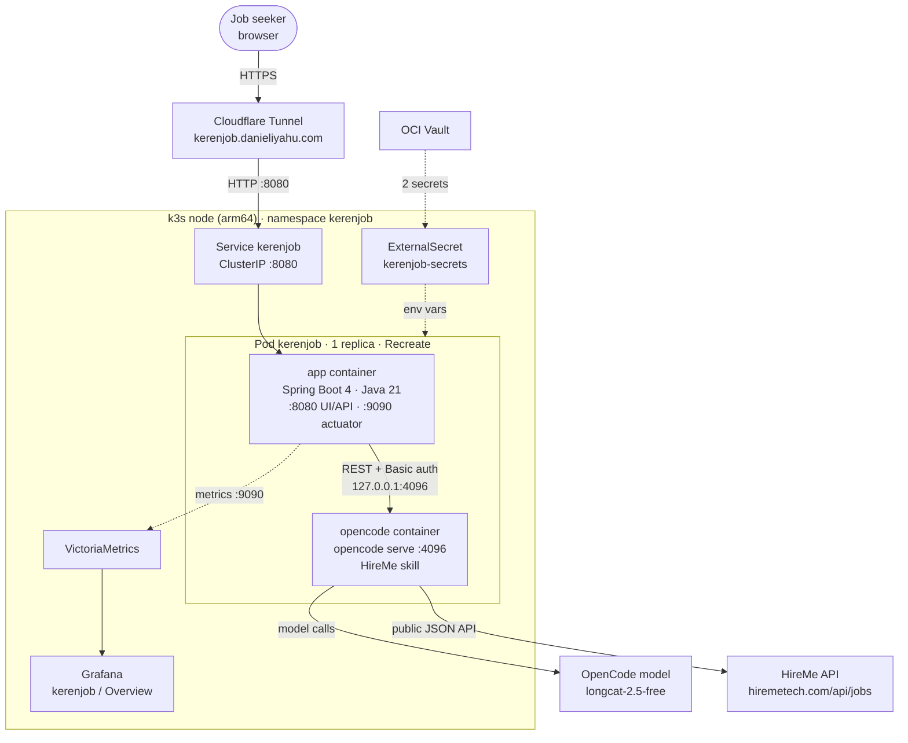
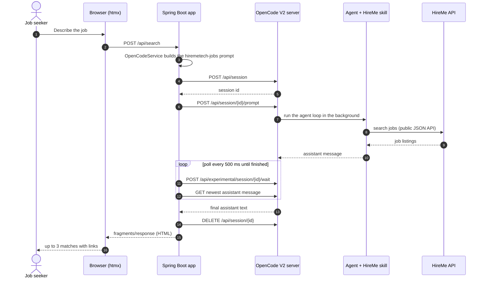
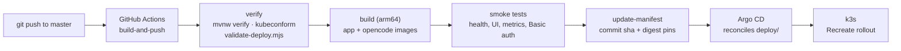

# keren-job

[](https://github.com/danieliyahu1/keren-job/actions/workflows/build-and-push.yaml)

Describe a job in plain language; an agent searches HireMe and returns matches.

One pod, two containers: a Spring Boot UI/API and a headless OpenCode agent
runtime. The app never searches a job board itself — it asks the agent, and the
agent calls HireMe's public JSON API. The image carries no browser.

## Architecture



| Container | Image | Role |
|---|---|---|
| `app` | `ghcr.io/danieliyahu1/keren-job` | Spring Boot 4 UI/API on `:8080`; operational endpoints on `:9090` |
| `opencode` | `ghcr.io/danieliyahu1/keren-job-opencode` | `opencode serve` on `:4096`: the agent runtime with the `hiremetech-jobs` skill |

The containers share a pod so the app can reach OpenCode on loopback
(`http://127.0.0.1:4096`); the port is never exposed through a Service. Both
images are pinned to a commit SHA **and** a registry digest.

## How a search flows



`ChatClient` is wired to `OpenCodeChatModel` (the `@Primary` `ChatModel`), which
speaks the OpenCode V2 REST API directly. A call creates a fresh session, admits
the prompt, waits for the newest assistant message to finish, reads its text,
and deletes the session in a `finally` block.

## Project layout

```
src/main/java/com/akatsuki/keren_job/
├── controller/         HomeController, SearchController, GlobalExceptionHandler
├── service/            OpenCodeService — prompt building and ChatClient calls
├── opencode/           OpenCodeChatModel — OpenCode V2 REST client
├── config/             ChatClientConfig, OpenCodeProcessManager (local auto-start)
└── dto/                JobResult
src/main/resources/
├── templates/          Thymeleaf index and HTMX fragments
└── application.properties
agent/                  opencode.json and the hiremetech-jobs skill
deploy/                 namespace, Deployment, Services, ConfigMap, ExternalSecret,
                        VMServiceScrape, Grafana dashboard
scripts/                manifest pinning and delivery-contract validation
Dockerfile              multi-stage build for the Spring Boot app
Dockerfile.opencode     OpenCode sidecar (no browser)
```

## Run locally

```bash
cp .env .env.local   # fill in the secrets, then use that file
docker compose up --build
```

`docker-compose.yml` runs both services and publishes the app on
<http://localhost:8080>. The app talks to OpenCode at `OPENCODE_BASE_URL`
(`http://opencode:4096` under compose, loopback in Kubernetes).

## Configuration

| Variable | Used by | Meaning |
|---|---|---|
| `OPENCODE_API_KEY` | opencode | Credential for the free `opencode/*` model in `agent/opencode.json` |
| `OPENCODE_PASSWORD` | both | Shared HTTP Basic password for the OpenCode V2 server (user `opencode`) |
| `OPENCODE_BASE_URL` | app | Where the app reaches the OpenCode server |
| `OPENCODE_AUTO_START` | app | Keep `false` in containers; the runtime owns its lifecycle |
| `OPENCODE_TIMEOUT_SECONDS` | app | Request budget for a search (default 600) |
| `PORT`, `METRICS_PORT` | app | Public HTTP port (8080) and internal actuator port (9090) |

The committed `.env` is gitignored. Never commit real credentials.

## Tests

```bash
./mvnw verify
```

Unit and slice tests cover the OpenCode client, the search service, both
controllers, and the Spring context. `scripts/validate-deploy.mjs` additionally
checks the delivery contract (image pins, probes, scrape target, dashboard).

## Deploy

`deploy/` is the whole deployment. Argo CD watches it directly
(`kubernetes/applications/kerenjob.yaml` in `oci-k3s-starter`), so pushing to
`master` is the deploy action:



1. `build-and-push` verifies the build and manifests, publishes both arm64
   images to ghcr.io, and commits the pinned `sha-<commit>@sha256:<digest>` refs
   into `deploy/deployment.yaml`.
2. Argo reconciles the cluster to that commit.

The opencode image is rebuilt only when its inputs change
(`Dockerfile.opencode`, `opencode-entrypoint.sh`, `agent/**`, or the workflow
that builds and smoke-tests it), so app-only commits do not republish it.

Secrets never live in Git. `deploy/externalsecret.yaml` names two OCI Vault
entries and the `oci-vault` ClusterSecretStore resolves them at runtime:

```
k3s-01-kerenjob-opencode-api-key
k3s-01-kerenjob-opencode-password
```

The OpenCode V2 server always requires HTTP Basic auth (user `opencode`). If
`OPENCODE_PASSWORD` is empty it generates a random password that nothing can
read, and every client and probe gets 401 — so the password is a required
secret, shared by the server and the app, and the sidecar probes authenticate
from inside the container.

Public traffic arrives through the Cloudflare tunnel at
`kerenjob.danieliyahu.com` → `kerenjob.kerenjob.svc.cluster.local:8080`. The
service is intentionally public (no Access policy), which means anyone with the
URL can spend your model quota.

## Monitoring

- `/actuator/health`, `/actuator/prometheus` on the internal port 9090.
- `VMServiceScrape kerenjob` scrapes it every 20 s as `job="kerenjob"`.
- Grafana dashboard `kerenjob / Overview` (ConfigMap in `observability`).

## Known limits

- **Searches longer than 100 s fail in the browser.** Cloudflare closes proxied
  requests at 100 s; the POST completes server-side and shows up in the logs and
  the `kerenjob / Overview` dashboard, but the client gets a 524. This is a
  property of the current synchronous endpoint, not the deployment.
- HireMe is the only source: a rate limit (HTTP 429) or an API error fails the
  whole search. There is no fallback board.
- `Dockerfile.opencode` installs the OpenCode CLI without a version pin, so a
  rebuild follows upstream releases. Pin it if you need reproducible rebuilds.
